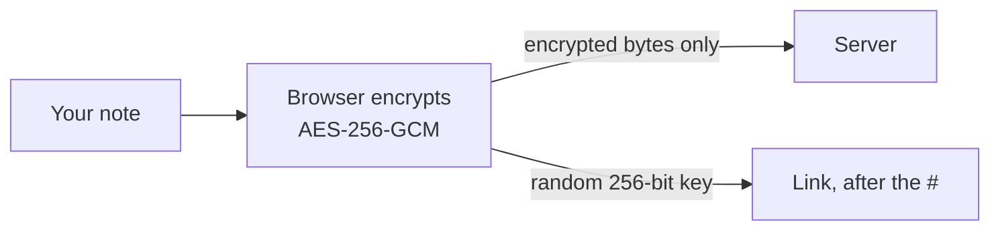

 

[Oryph](https://oryph.com) &nbsp;·&nbsp; [vdlsm.org](https://vdlsm.org) &nbsp;·&nbsp; [cnw.bio](https://cnw.bio)

 

## Projects

<b>How vdlsm.org encryption works</b>

 

Your browser generates a random 256-bit key and encrypts the note with **AES-256-GCM** before anything is uploaded. The server only receives encrypted bytes. The key is put into the link after the `#`, a part browsers never send to a server.

 

## IT Experience

 

Switzerland

